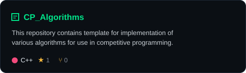
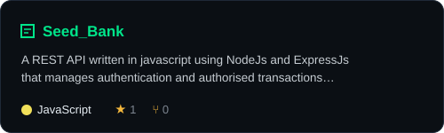
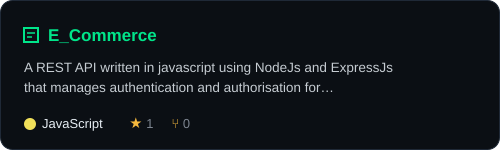
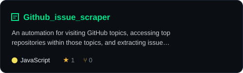
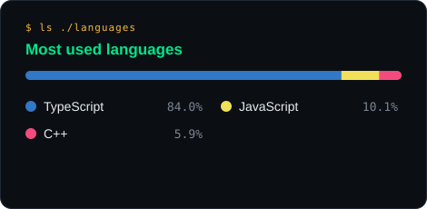
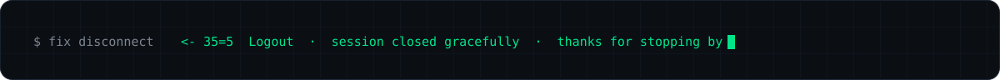

<a href="https://www.linkedin.com/in/utsavup/">
  
</a>

<p align="center">
  <a href="https://www.linkedin.com/in/utsavup/"></a>
  <a href="https://codeforces.com/profile/utsav_upadhyay"></a>
  <a href="https://leetcode.com/u/utsav_upadhyay/"></a>
  <a href="https://atcoder.jp/users/utsav_upadhyay"></a>
  <a href="https://x.com/utsav08_"></a>
</p>



## `$ cat about.yaml`

```yaml
engineer:
  name:      Utsav Upadhyay
  role:      Software Engineer, Fixed Income Connectivity @ ION Trading
  based_in:  Noida, India
  focus:     [trading connectivity, low-latency backends, distributed systems]

shipped:
  - FIX 4.4 connectivity to new trading venues, from logon to order flow
  - Integrations with electronic bond-trading platforms through vendor APIs
  - C# trading plugins running in production
  - Jenkins CI/CD pipelines for release automation

competitive_programming:
  codeforces:       Expert            # utsav_upadhyay
  icpc:             Regionals 2023
  amazon_hackon_s3: Top 50 nationally (+ internship offer)
  also_on:          [LeetCode, AtCoder, CodeChef]

education:   B.Tech CSE (AI & ML), JSS Academy of Technical Education, Noida, 2021–2025
building:    Build-or-Not, a fault-tolerant multi-LLM evaluation pipeline (45 independent judges)
demo:        https://build-or-not.onrender.com/
currently:   Going deep on system design at scale: consistency, replication, partitioning
```

## `$ ls ./stack`

<p align="left">
  
</p>

## `$ ls ./projects --pinned`

<a href="https://build-or-not.onrender.com/">
  
</a>

<p align="center">
  <a href="https://build-or-not.onrender.com/"></a>
  <a href="https://github.com/UtsavUpadhyay08/Build-or-Not"></a>
  <a href="https://github.com/UtsavUpadhyay08/Build-or-Not/blob/main/DESIGN.md"></a>
  <br><sub>Free-tier hosting: the first load can take ~30s while the server wakes up.</sub>
</p>

<p align="center">
  <a href="https://github.com/UtsavUpadhyay08/CP_Algorithms"></a>
  <a href="https://github.com/UtsavUpadhyay08/Seed_Bank"></a>
  <a href="https://github.com/UtsavUpadhyay08/E_Commerce"></a>
  <a href="https://github.com/UtsavUpadhyay08/Github_issue_scraper"></a>
</p>

<details>
  <summary><b>More of the projects</b> (CLI tools and automation)</summary>
  <br>

  - [Hackerrank_Automation_Tool](https://github.com/UtsavUpadhyay08/Hackerrank_Automation_Tool)
  - [FileOrganiser](https://github.com/UtsavUpadhyay08/FileOrganiser)
  - [wcat_commands](https://github.com/UtsavUpadhyay08/wcat_commands)
</details>

## `$ git log --stats`

<!-- Cards in assets/generated/ are rebuilt daily from the GitHub API by .github/workflows/profile-cards.yml -->

<p align="center">
  
  
</p>

<p align="center">
  
</p>

<p align="center">
  
</p>

<p align="center">
  
</p>


